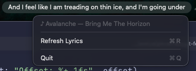
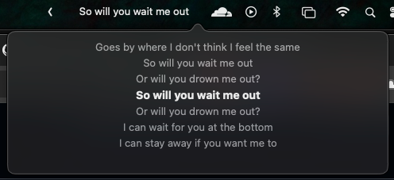
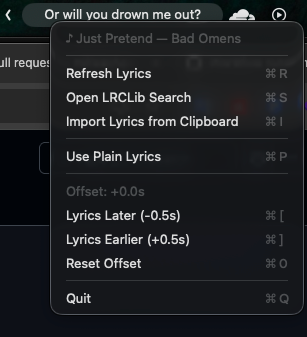

# Spotify Lyrics Menu Bar

A tiny native macOS menu bar app that shows time-synced lyrics for the song currently playing in the Spotify desktop app.

This Swift/AppKit version packages the same idea as a native macOS `.app` for people who prefer a drag-and-drop install.

Inspired by Nadia Lovely's original Python project: https://github.com/nadialvy/spotify-lyrics-menubar







## Requirements

- macOS
- Spotify desktop app

## Install

1. Download `SpotifyLyricsMenuBar.dmg` from the [latest GitHub Release](https://github.com/mifwar/spotify-lyrics-menubar-swift/releases).
2. Open the DMG.
3. Drag `SpotifyLyricsMenuBar.app` to Applications.
4. Right-click `SpotifyLyricsMenuBar.app` in Applications and choose Open.
5. Confirm Open when macOS asks.

On first launch, macOS may ask for Automation permission so the app can read the current Spotify track and playback position.

If macOS still blocks the app, open System Settings > Privacy & Security, then choose Open Anyway for SpotifyLyricsMenuBar.

Note: release builds are not notarized yet, so macOS may show an "unidentified developer" warning after download.

Use the menu bar app menu to move lyric timing earlier or later in 0.5 second steps. The offset is saved per song automatically.

Click the menu bar icon to open a popover showing the current line and surrounding lyrics.

## Display Modes

The app has two display modes. Switch between them from the menu bar menu under **Display Mode**:

- **Menu Bar** (default): the current lyric line appears directly in the menu bar.
- **Floating**: the menu bar item shrinks to a compact `♪` indicator and the lyrics move to a small floating panel showing the current line with its surrounding lines.
- **Notch**: the lyrics attach to the notch and expand downward on hover. See below.

Floating mode is useful when menu bar space is limited, for example on MacBooks with a notch.

The floating panel can be dragged anywhere by its background and resized from its edges or corners. Making it shorter reveals fewer surrounding lines, down to just the current line; making it taller reveals them again (up to 3 lines before and after the current one). Dragging or resizing never steals keyboard focus from other apps.

The selected display mode and the panel's position and size are persisted and restored on the next launch.

### Notch

In notch mode the menu bar item disappears and the current lyric line attaches to the notch itself, so nothing competes for menu bar space.

- **Hover** the notch to expand it downward into five lines (the current one plus two either side) with the track artwork.
- **Click a line** to seek to it. Seeking is disabled when the timing is estimated (plain lyrics fallback, imported lyrics without timestamps), because those timestamps are spread evenly rather than measured.
- **Click the current line**, or the padding around it, to pin the panel open. A pinned panel ignores hover-out and the paused idle shrink; click again to unpin.
- **Right-click** the panel for the usual menu: refresh, LRCLib search, clipboard import, plain lyrics, timing offsets.
- Pausing shrinks it to a small dot after three seconds. With no track at all the dot stays, so the menu is always one right-click away even when Spotify is closed; left-clicking the dot opens the menu.
- Over a fullscreen app that is not Spotify it hides, unless **Show over fullscreen apps** is checked in the menu (off by default).

Displays without a notch, and external monitors, get the same pill at the top center of the screen instead of hanging off a cutout. **Display** in the menu picks which screen it attaches to; the choice is remembered by display, so it survives reconnects.

Expansion, hover-out and the paused dot are all resolved from one state, so pinning while paused does not fight the idle timer.

## Development

Build the app locally:

```bash
make app
```

Run the local build:

```bash
make run
```

Build a local DMG:

```bash
make dmg
```

The GitHub Actions release workflow builds and uploads `SpotifyLyricsMenuBar.dmg` automatically when you push a version tag like `v1.0.0`.

## How It Works

- Reads the current track, artist, and playback position from Spotify via AppleScript.
- Fetches synced lyrics from lrclib.net and caches successful matches locally.
- Falls back to plain lyrics with estimated timing when synced lyrics are unavailable.
- Retries failed lyric lookups and can open LRCLib search for manual recovery.
- Updates the menu bar title as the song progresses.
- Click the menu bar icon to see a 7-line lyrics panel.

## Menu Actions

- **Refresh Lyrics** — Refetches the current song and bypasses the local lyrics cache.
- **Open LRCLib Search** — Opens LRCLib search for the current track.
- **Import Lyrics from Clipboard** — Imports copied LRC lyrics for the current song and saves them to the local cache.
- **Use Plain Lyrics** — Ignores synced timestamps and spreads plain lyric lines across the song duration.
- **Lyrics Earlier / Later** — Saves a per-song timing offset in 0.5 second steps.

## Troubleshooting Sync Issues

If the synced lyrics are consistently off — some parts too fast, some too slow — the LRC file itself may be poorly timed. Two options:

1. **Use Plain Lyrics** — Toggle "Use Plain Lyrics" from the menu. This ignores the LRC timestamps and spaces lines evenly across the song duration. The toggle resets automatically for the next song.
2. **Adjust Offset** — Use "Lyrics Earlier / Later" to shift all lines by 0.5s steps. Good for constant-speed mismatches. Offsets are saved per song across launches.
